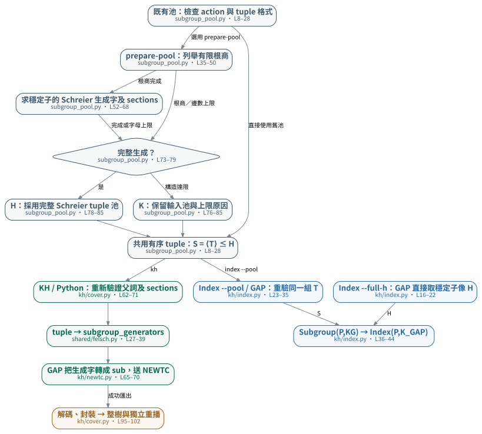

# Program A source map

Source revision [3d109382](https://github.com/junwenwaynepeng/IteratedMonodromyGroup/tree/3d109382d4645093fabb505632eaacd50e24aa04/program-a).

[Download the interactive source atlas](control-flow.html?raw=true) and open it locally to inspect all six commands, branch targets, limits, tests and the source-line index.

| Operation | Source |
|---|---|
| 既有池：檢查 action 與 tuple 格式 | [subgroup_pool.py · L8–28](https://github.com/junwenwaynepeng/IteratedMonodromyGroup/blob/3d109382d4645093fabb505632eaacd50e24aa04/program-a/program_a/subgroup_pool.py#L8-L28) |
| prepare-pool：列舉有限根商 | [subgroup_pool.py · L35–50](https://github.com/junwenwaynepeng/IteratedMonodromyGroup/blob/3d109382d4645093fabb505632eaacd50e24aa04/program-a/program_a/subgroup_pool.py#L35-L50) |
| 求穩定子的 Schreier 生成字及 sections | [subgroup_pool.py · L52–68](https://github.com/junwenwaynepeng/IteratedMonodromyGroup/blob/3d109382d4645093fabb505632eaacd50e24aa04/program-a/program_a/subgroup_pool.py#L52-L68) |
| 完整生成？ | [subgroup_pool.py · L73–79](https://github.com/junwenwaynepeng/IteratedMonodromyGroup/blob/3d109382d4645093fabb505632eaacd50e24aa04/program-a/program_a/subgroup_pool.py#L73-L79) |
| H：採用完整 Schreier tuple 池 | [subgroup_pool.py · L78–85](https://github.com/junwenwaynepeng/IteratedMonodromyGroup/blob/3d109382d4645093fabb505632eaacd50e24aa04/program-a/program_a/subgroup_pool.py#L78-L85) |
| K：保留輸入池與上限原因 | [subgroup_pool.py · L76–85](https://github.com/junwenwaynepeng/IteratedMonodromyGroup/blob/3d109382d4645093fabb505632eaacd50e24aa04/program-a/program_a/subgroup_pool.py#L76-L85) |
| 共用有序 tuple：S = ⟨T⟩ ≤ H | [subgroup_pool.py · L8–28](https://github.com/junwenwaynepeng/IteratedMonodromyGroup/blob/3d109382d4645093fabb505632eaacd50e24aa04/program-a/program_a/subgroup_pool.py#L8-L28) |
| KH / Python：重新驗證父詞及 sections | [kh/cover.py · L62–71](https://github.com/junwenwaynepeng/IteratedMonodromyGroup/blob/3d109382d4645093fabb505632eaacd50e24aa04/program-a/program_a/kh/cover.py#L62-L71) |
| tuple → subgroup_generators | [shared/felsch.py · L27–39](https://github.com/junwenwaynepeng/IteratedMonodromyGroup/blob/3d109382d4645093fabb505632eaacd50e24aa04/program-a/program_a/shared/felsch.py#L27-L39) |
| GAP 把生成字轉成 sub，送 NEWTC | [kh/newtc.py · L65–70](https://github.com/junwenwaynepeng/IteratedMonodromyGroup/blob/3d109382d4645093fabb505632eaacd50e24aa04/program-a/program_a/kh/newtc.py#L65-L70) |
| 解碼、封裝 → 整樹與獨立重播 | [kh/cover.py · L95–102](https://github.com/junwenwaynepeng/IteratedMonodromyGroup/blob/3d109382d4645093fabb505632eaacd50e24aa04/program-a/program_a/kh/cover.py#L95-L102) |
| Index --pool / GAP：重驗同一組 T | [kh/index.py · L23–35](https://github.com/junwenwaynepeng/IteratedMonodromyGroup/blob/3d109382d4645093fabb505632eaacd50e24aa04/program-a/program_a/kh/index.py#L23-L35) |
| Index --full-h：GAP 直接取穩定子像 H | [kh/index.py · L16–22](https://github.com/junwenwaynepeng/IteratedMonodromyGroup/blob/3d109382d4645093fabb505632eaacd50e24aa04/program-a/program_a/kh/index.py#L16-L22) |
| Subgroup(P,KG) → Index(P,K_GAP) | [kh/index.py · L36–44](https://github.com/junwenwaynepeng/IteratedMonodromyGroup/blob/3d109382d4645093fabb505632eaacd50e24aa04/program-a/program_a/kh/index.py#L36-L44) |
